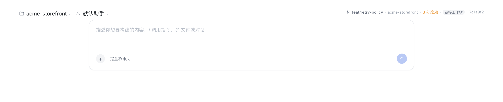
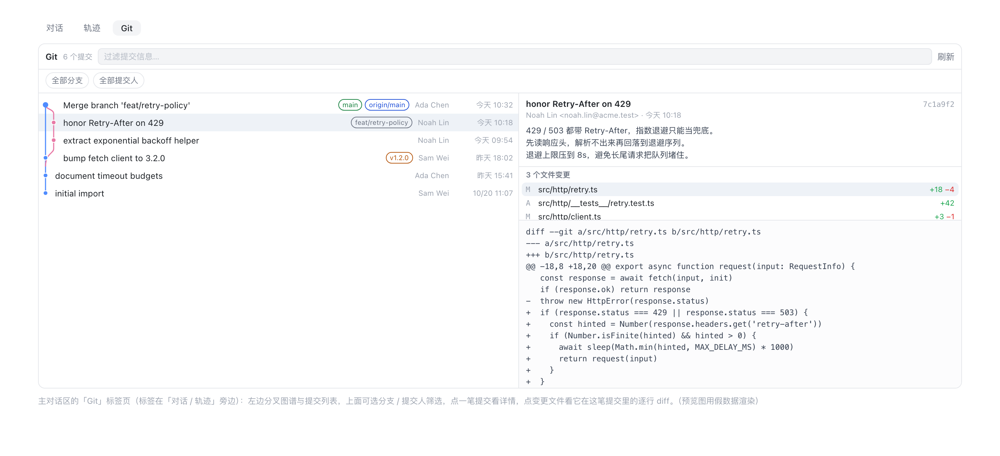
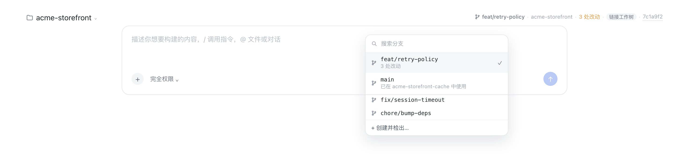
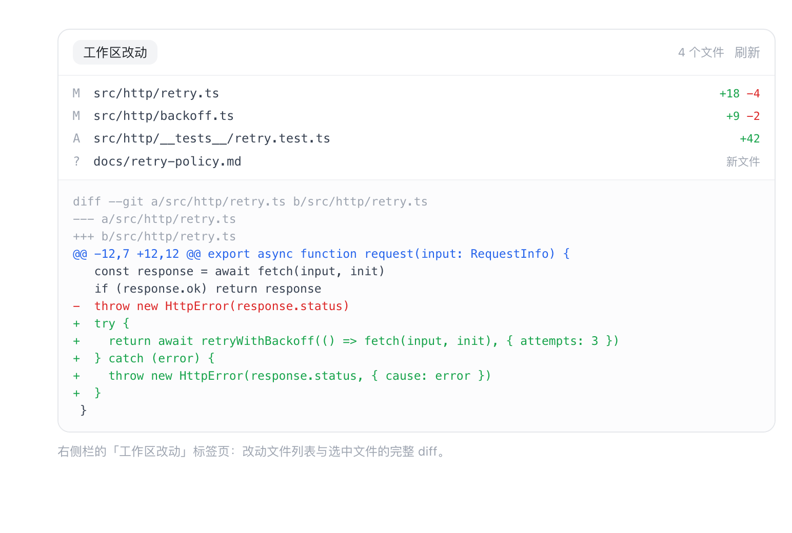

# dsh-git-bar

English | [简体中文](README.zh.md)

A DeepSeek Harness bundle that adds one ambient row above the composer showing
the Session's git context:

```
⎇ main · dsh-git-bar · 3 处改动 · ↑2 ↓1 · a1b2c3d
```



- repository name and root
- the branch the Session runs on, or `游离 HEAD` / `detached HEAD` when the HEAD
  is not on a branch
- working-tree change totals (staged / unstaged / untracked in the tooltip)
- ahead/behind counts against the upstream branch
- short commit id — clickable, opening that commit on the origin remote
  (GitHub, GitLab and Bitbucket commit routes are all handled) — and a
  `链接工作树` / `linked worktree` marker when the directory is a linked
  `git worktree`, or a `N 个工作树` marker when the repository has more than one
- every label is plain text: select it and copy it

The row refreshes every 8 seconds, on window focus, and when the Session
changes. Reading it never touches the repository; two interactions deliberately
do:

- **click the branch** — a searchable popover lists every local branch with its
  upstream, ahead/behind and dirty state, marks the current one, and can check one
  out or create a new branch from the current HEAD;
- **click the change count** — opens the working tree in the right-hand Sidebar
  as a `工作区改动` tab: the changed files, and the unified diff of the file you
  pick, untracked files included (diffed against `/dev/null`);
- **click the worktree marker** — lists every worktree of the repository with its
  branch and change count. `在此新建会话` opens a new Session in that worktree's
  directory — registering the directory as a workspace first when it is not one
  yet — (a worktree is a directory, so a Session is never moved between them),
  and `复制路径` copies it. A branch already checked out in another
  worktree is greyed out in the branch popover with the worktree that holds it,
  instead of failing with git's `already checked out` after the click.

The conversation also gains a **Git history** view tab. The left half is the
commit graph — one lane per line of history, each lane keeping its own colour,
merge commits drawing the line back into the lane it merged into — followed by
the commit list and a keyword filter, plus two dropdowns that narrow the list by
branch and by author — both run in git, so they apply to the whole history rather
than to the page already loaded. Each dropdown has its own search box and its
options scroll on their own, so a repository with hundreds of branches is still
usable; the author list comes from `/authors`, i.e. from every commit in the
repository, not just the page already loaded. Picking a commit reads its author, time, full
message and changed files; picking a file reads its unified diff inside that
commit. Scrolling to the bottom loads older commits by itself; there is no
"load more" button. The tab only reads: no ref, index or worktree is written.
- nothing here silently scrolls away: a drag that selects text does not also open
  a popover.







## Install

Requires **DSH >= 0.2.1-rc.2** and `git` on the Host's PATH. The plugin is
distributed through GitHub; an npm account is not required.

For the desktop app, use its own Plugin Manager's install/add entry and supply:

```text
git+https://github.com/mjnhmd/dsh-git-bar.git#d0a00951921ff92f16a16d6042834bad09542feb
```

Alternatively, search for **dsh-git-bar** in the community `dshmarket` plugin.
The desktop app does not necessarily use a CLI profile named `web` or `desktop`.

For a regular `dsh web` instance (replace `web` if you use another profile):

```bash
dsh plugin --profile web add "git+https://github.com/mjnhmd/dsh-git-bar.git#d0a00951921ff92f16a16d6042834bad09542feb"
```

For local development:

```bash
dsh plugin --profile web add link:/absolute/path/to/dsh-git-bar
```

The Host half loads at startup, so restart the app after the first install; the
Client half is served on the next page load.

## Publish

Market index (add under **插件 → 发现 → 添加索引源**):
<https://mjnhmd.github.io/dsh-git-bar/market/index.json>

DSH ships no index of its own: a plugin market is a JSON file (format 1) you host
yourself and add under **插件 → 发现 → 添加索引源**. `docs/market-index.example.json`
is a ready template, `scripts/validate-index.mjs` checks it against DSH's own
validator, and [docs/PUBLISH.zh.md](docs/PUBLISH.zh.md) walks through pushing the
repository, publishing to npm, and publishing the index.

Community listing: <https://awesome-dsh-plugin.com/p/mjnhmd/dsh-git-bar/>.
This is separate from the self-hosted index above.

### Marketplace screenshots

The root [screenshots.json](screenshots.json) declares the three preview images
in display order, using paths relative to that file. The community directory's
next nightly build picks up the manifest after it is pushed; changing a local
file or embedding images in the README alone does not update the listing card.

All previews use fictional data rendered from `scripts/previews/`. Do not replace
them with screenshots containing real workspace, session or private project data.

## Host API

`GET /dsh-git-bar/info?sessionId=<id>[&dir=<absolute path>]`

- admitted through the harness browser session (`ctx.connection.requestRejection`),
  so it is unreachable without the GUI's own credentials;
- the directory comes from the Session store first; `dir` is only a fallback for
  a Session the store does not know, and must be absolute;
- replies with `{ dir, repository: null | { root, name, branch, detached, sha,
  commitUrl, remote, dirty: { changed, staged, unstaged, untracked }, upstream,
  ahead, behind, worktree: { linked, mainRoot, count } } }`;
- `commitUrl` is derived from the `origin` remote: the scp, `ssh://`, `git://`
  and http(s) forms all normalize to `https://host/owner/repo`, and the commit
  route follows the host (GitHub `/commit/`, GitLab `/-/commit/`, Bitbucket
  `/commits/`). A local-path remote yields `null` and the id stays plain text.

`GET /dsh-git-bar/branches?sessionId=<id>` — `{ branches: [{ name, current,
upstream, ahead, behind, subject, checkedOutIn }], dirty }`, where
`checkedOutIn` is the worktree path holding that branch (a branch can only be
checked out in one worktree at a time).

`GET /dsh-git-bar/worktrees?sessionId=<id>` — `{ root, worktrees: [{ path, name,
branch, detached, sha, bare, locked, prunable, main, current, dirty }] }`, each
worktree costing one `status` call for its own change count.

`POST /dsh-git-bar/branches/checkout` `{ sessionId, branch }` — `{ branch,
created: false }`; 409 when git refuses (local changes, unknown branch).

`POST /dsh-git-bar/branches/create` `{ sessionId, name, from? }` — `{ branch,
created: true }`; the name is validated with `git check-ref-format --branch`.

`GET /dsh-git-bar/changes?sessionId=<id>` — `{ files: [{ path, status, staged,
additions, deletions }], dirty, truncated }`, capped at 500 files.

`GET /dsh-git-bar/diff?sessionId=<id>&path=<repo-relative>&staged=0|1` — `{ path,
staged, diff, truncated }`, capped at 200 000 characters.

`GET /dsh-git-bar/authors?sessionId=<id>` — `{ dir, authors: [{ name, email,
count }], truncated }`, aggregated over `git log --all`, most commits first, tied
names alphabetical, capped at 500 rows. It exists so the author filter can offer
people who only appear deeper in the history than the current page.

`GET /dsh-git-bar/log?sessionId=<id>[&limit=1..300][&skip=0..][&branch=<ref>][&author=<text>]`
— `{ dir, commits, hasMore, truncated, filters: { branch, author } }`, where each commit is `{ hash, short, parents, author, email, when,
subject, refs: [{ name, kind }] }`. `kind` is `head`, `local`, `remote` or `tag`,
and `name` is the short ref name (the same form `/branches` reports). 60 commits
by default, 300 at most; `skip` is how many commits the caller already has, which
is how the panel pages through a history longer than one page.

`GET /dsh-git-bar/commit?sessionId=<id>&hash=<4..40 hex>` — `{ dir, hash, short,
parents, author, email, when, subject, body, files, truncated }`, each file being
`{ path, status, additions, deletions, binary }`, capped at 500 files.

`GET /dsh-git-bar/commit-diff?sessionId=<id>&hash=<4..40 hex>&path=<repo-relative>`
— `{ dir, hash, path, diff, truncated }`: one file's unified diff inside that
commit, also capped at 200 000 characters.

Every git call uses an argument array (no shell), a 4 s timeout, and a 256 KiB
buffer cap. Nothing is watched and nothing is cached.

## Layout

| File | Role |
|---|---|
| `index.js` | Host half: the read-only JSON routes over the `git` executable, including the three history routes |
| `client.js` | Client half: the `conversation.input.dock` row, the branch popover, the Sidebar tab body, and the `conversation.view` Git history tab |
| `cordis.patch.yml` | Bundle patch that inserts the `git-bar` row |
| `locale/*.json` | Display metadata for Plugin Manager / Settings |
| `icon.svg` | Plugin icon |
| `docs/PUBLISH.zh.md` | How to distribute the plugin (Git / npm / a market index) |
| `docs/market-index.example.json` | Format-1 market index template |
| `scripts/validate-index.mjs` | Rejects an index the way DSH's reader would |
